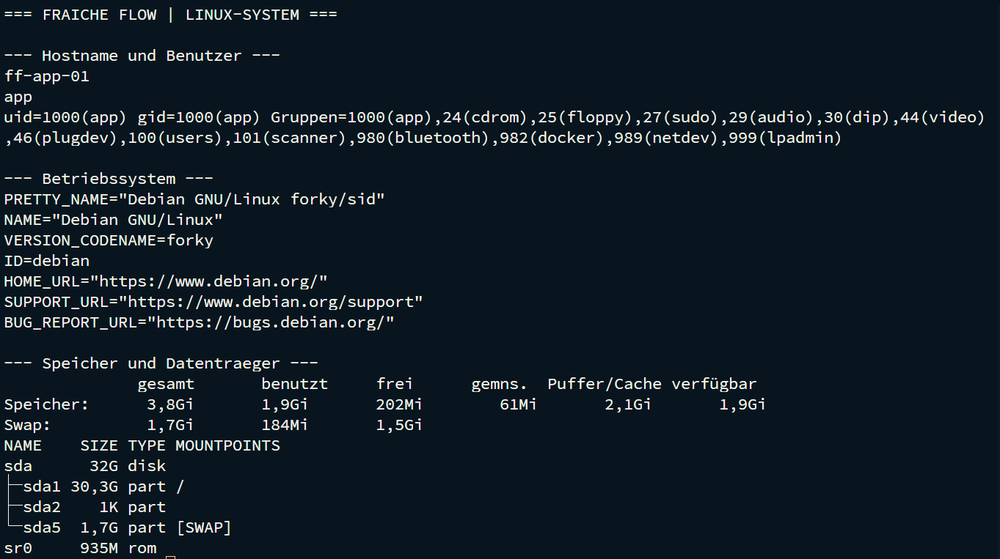
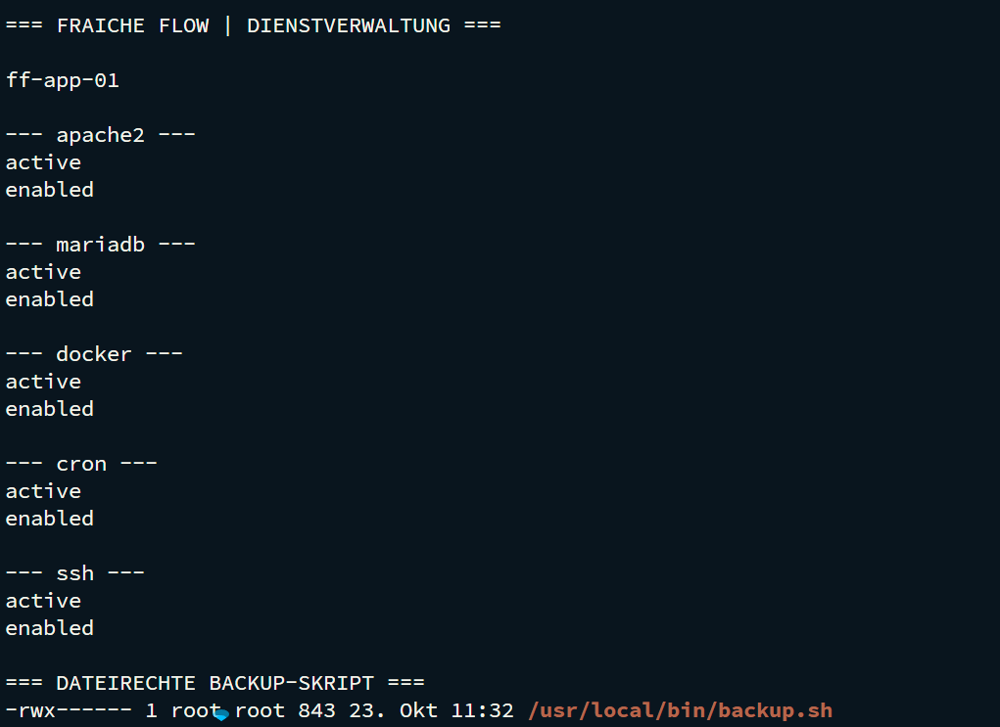

# Linux-Administration und Shell


PROJEKT / Grundlagen · Linux · Bash

Fraîche Flow · Fachinformatik Systemintegration

## Projektziel

Eine konsistente Kommandozeilen-Arbeitsweise für Installation, Konfiguration, Diagnose und Automatisierung der Laborinfrastruktur aufbauen.

## Meine Umsetzung

- Linux-Systeme über Bash administriert und Benutzer, Hostname sowie Arbeitsverzeichnis anhand des Prompts unterschieden.
- Konfigurationsdateien mit nano bearbeitet und Inhalte mit cat, grep und tail geprüft.
- Ausgaben mit Pipes, Umleitungen und Filtern für nachvollziehbare Diagnoseketten aufbereitet.
- Paketverwaltung, Dateirechte, Eigentümer und systemd-Dienste im praktischen Betrieb eingesetzt.

## Technischer Rahmen

| **Plattform**    | Debian Linux                                        |
| ---------------- | --------------------------------------------------- |
| **Werkzeuge**    | Bash, nano, grep, tail, apt, systemctl              |
| **Arbeitsweise** | Diagnose vor Änderung; Ergebnis anschließend prüfen |



## Ergebnis

Die Shell wurde durchgehend für den Aufbau und die Fehlersuche eingesetzt. Konkrete Ausgaben zu Diensten, Netzwerk, Dateisystemen und Containern sind im Projektverlauf dokumentiert.

## Prüfpfad und Betriebsnachweise

```bash
hostname; whoami; pwd
ip -br a; ip route
systemctl is-active apache2 mariadb docker cron
df -h /tmp /var; lsblk
```



## Troubleshooting aus der Praxis

Nextcloud wurde unter `/var/www` heruntergeladen und entpackt. Die Trennung zwischen temporärem tmpfs und dauerhaftem Dateisystem war bei der Wahl des Arbeitsverzeichnisses zu beachten.

## Kompetenztransfer

Linux-Betrieb, Dateisystemanalyse, Dienstverwaltung und strukturierte Fehlereingrenzung.

## Projektstatus

Abgeschlossen nach Bestätigung des Projektverantwortlichen.


