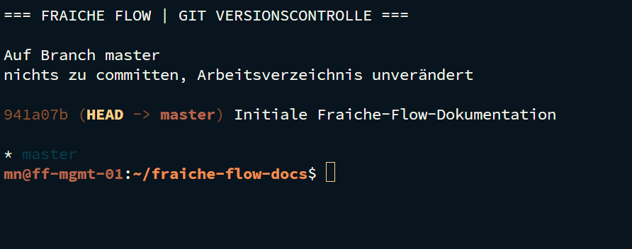

# Git und versionierte Dokumentation

MILOUD NECILI

PROJEKT / Git CLI

Fraîche Flow · Fachinformatik Systemintegration

## Projektziel

Änderungen an Dokumentation und Administrationsartefakten nachvollziehbar organisieren und einen sicheren Arbeitsablauf mit Git darstellen.

## Meine Umsetzung

- Git-CLI-Aufgaben im Rahmen des Lernfelds bearbeitet und Repository-Arbeit als Grundlage der Projektdokumentation eingesetzt.
- Working Directory, Staging Area und Commit als getrennte Arbeitsstände behandelt.
- Branches, Zusammenführung, Konfliktbearbeitung und Revert im Aufgabenbereich bearbeitet.
- Konfigurationen und Skripte strukturiert und ohne sensible Daten abgelegt.

## Technischer Rahmen

| **Artefakte**     | README, Betriebsnotizen, Konfigurationsbeispiele, Skripte |
| ----------------- | --------------------------------------------------------- |
| **Arbeitsablauf** | Änderung prüfen → stagen → committen → synchronisieren    |
| **Nachweisart**   | Abschluss vom Projektverantwortlichen bestätigt           |

## Ergebnis

Der Aufgabenbereich ist nach Angabe des Projektverantwortlichen abgeschlossen.

## Prüfpfad und Betriebsnachweise

```bash
git status
git log --oneline --graph --all
git branch --all
git diff
```



## Troubleshooting aus der Praxis

Änderungen an derselben Datei müssen fachlich aufgelöst werden; ein erfolgreicher Merge allein ersetzt keine inhaltliche Prüfung.

## Sicherheit und fachliche Einordnung

Keine `.env`-Dateien, Tokens, privaten Schlüssel oder produktiven Zugangsdaten versionieren. Bereits veröffentlichte Geheimnisse ersetzen; das Löschen aus der aktuellen Datei entfernt sie nicht aus der Historie.

## Kompetenztransfer

Versionskontrolle, nachvollziehbare Änderungen, Teamfähigkeit technischer Dokumentation.

## Projektstatus

Abgeschlossen nach Bestätigung des Projektverantwortlichen.


