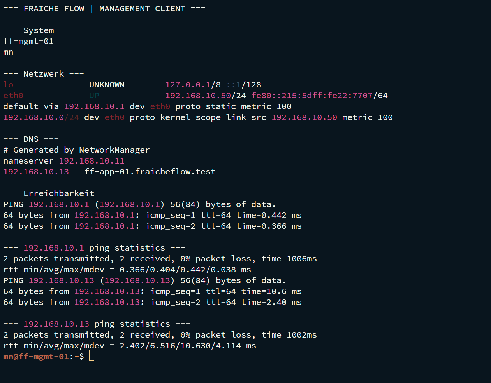

# Linux-Management-Client und lokales IAM


Fraîche Flow · Fachinformatik Systemintegration

## Projektziel

Einen Linux-Arbeitsplatz für Administration, Netzwerktests und reproduzierbare Betriebsdokumentation bereitstellen.

## Meine Umsetzung

- ff-mgmt-01 als Administrationsclient verwendet und von dort SSH-, DNS- und HTTP-Tests durchgeführt.
- Benutzer-, Gruppen-, Homeverzeichnis- und Login-Verhalten im lokalen IAM-Aufgabenbereich bearbeitet.
- Testkonten berti und schorsch sowie die Gruppe stammtisch als Aufgabenbestandteil behandelt; der Abschluss ist vom Projektverantwortlichen bestätigt.
- Runbook-, Test- und Log-Strukturen für die Administration dokumentiert.

## Technischer Rahmen

| **System**                             | ff-mgmt-01                                                 |
| -------------------------------------- | ---------------------------------------------------------- |
| **Rolle**                              | Management und Diagnose                                    |
| **Benutzer im nachgewiesenen Zugriff** | mn                                                         |
| **Adressierung**                       | Im Verlauf DHCP-Adresse .100 und spätere Zugriffe über .50 |

## Ergebnis

Der SSH-Zugriff von ff-mgmt-01 auf ff-app-01 und HTTP-Zugriff auf das Portal wurden durch Terminalausgaben belegt. Für die einzelnen IAM-Teilschritte liegen in dieser Sammlung keine separaten Originalausgaben vor.

## Prüfpfad und Betriebsnachweise

```bash
hostname; whoami; groups
ip -br a; ip route; cat /etc/resolv.conf
getent hosts ff-app-01.fraicheflow.test
ssh app@ff-app-01.fraicheflow.test
```



## Troubleshooting aus der Praxis

Im Projektverlauf wurden Clientadresse und DNS-Eintrag gemeinsam geprüft. Die DHCP-Adresse .100 wich zeitweise vom DNS-Eintrag .50 ab; die Namensauflösung musste zum tatsächlichen Adressstand passen.

## Sicherheit und fachliche Einordnung

Temporäre IAM-Konten nach der Übung entfernen. Gruppenmitgliedschaften und sudo-Rechte begrenzen. DHCP- und DNS-Adressstände gemeinsam pflegen.

## Kompetenztransfer

Clientbereitstellung, lokale Identitätsverwaltung, DNS-Diagnose und Remote-Administration.

## Projektstatus

Abgeschlossen nach Bestätigung des Projektverantwortlichen.


