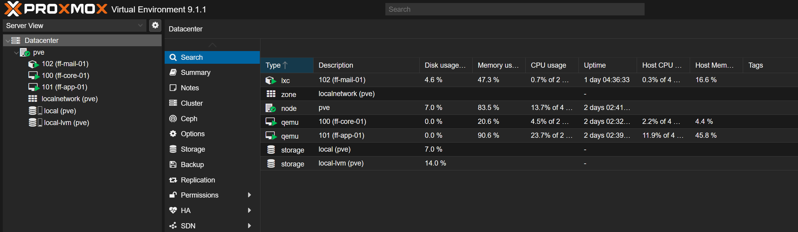
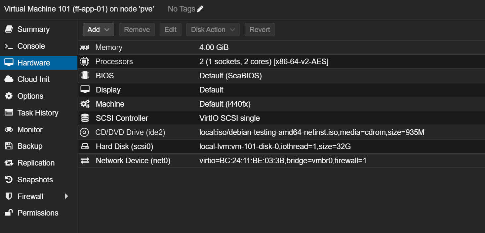

# Architektur und Virtualisierung

MILOUD NECILI

Fraîche Flow · Fachinformatik Systemintegration

## Projektziel

Eine mehrstufige Laborumgebung mit getrennten Rollen für Management, Netzwerk, Storage, Anwendungen und Kommunikation strukturieren.

## Meine Umsetzung

- Mit Hyper-V und Proxmox im Rahmen des Laboraufbaus gearbeitet.
- Die Rollen ff-edge-01, ff-pve-01, ff-core-01, ff-store-01, ff-app-01 und ff-mgmt-01 im internen Netz zusammengeführt.
- ff-mail-01 als separaten Mail-Host im Proxmox-/LXC-Kontext bearbeitet.
- Abhängigkeiten zwischen DNS, Storage, Webanwendung, Datenbank und Administration dokumentiert.



## Technischer Rahmen

| **Lab-Netz**             | 192.168.10.0/24           |
| ------------------------ | ------------------------- |
| **Gateway**              | ff-edge-01 · 192.168.10.1 |
| **Hypervisor**           | ff-pve-01 · 192.168.10.10 |
| **Core / Storage / App** | 192.168.10.11 / .12 / .13 |



## Ergebnis

Die Anwendungsebene und die Kommunikation zwischen den Laborrollen wurden praktisch genutzt.

## Prüfpfad und Betriebsnachweise

```bash
hostname; ip -br a; ip route
lsblk; df -h
systemctl --type=service --state=running --no-pager
docker ps
```

## Troubleshooting aus der Praxis

Die Paketquellen von ff-app-01 zeigten forky. Die tatsächliche Plattform wurde deshalb getrennt von älteren Debian-12-Aufgabenvorgaben betrachtet. Konkrete VM-Ressourcen sind vor einer erneuten Bereitstellung zu exportieren.

## Sicherheit und fachliche Einordnung

Ein erfolgreiches Schulungslabor ist kein Hochverfügbarkeitsnachweis. Produktive Freigabe benötigt separate Kapazitäts-, Lifecycle- und Sicherheitsentscheidungen.

## Kompetenztransfer

Architekturverständnis, Virtualisierung, Rollenmodell und Abhängigkeitsanalyse.

## Projektstatus

Abgeschlossen nach Bestätigung des Projektverantwortlichen.


