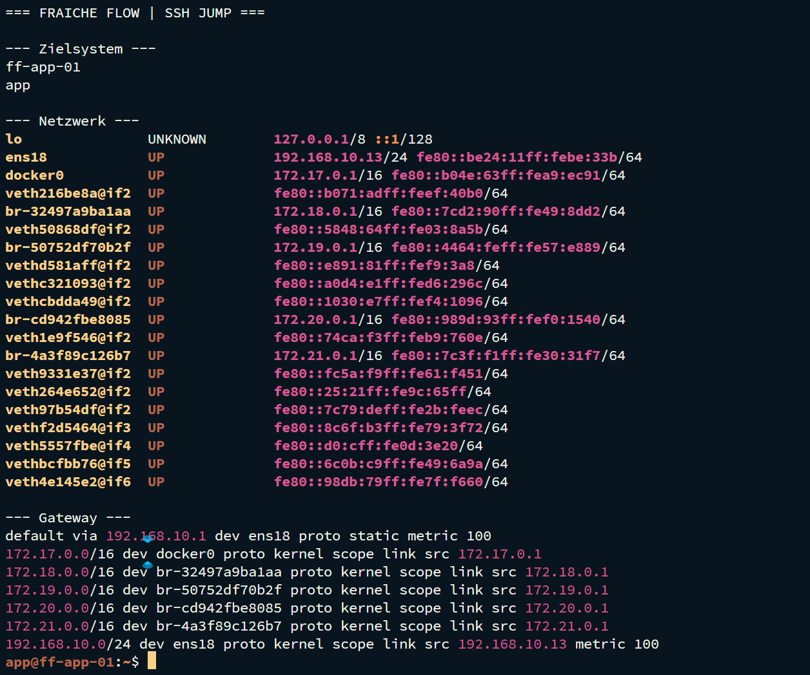
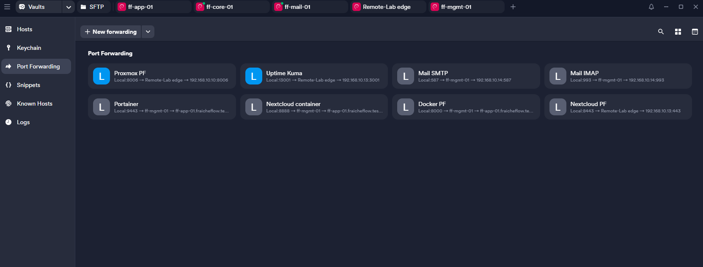

# Edge-Zugriff und SSH-Portweiterleitung

MILOUD NECILI

Fraîche Flow · Fachinformatik Systemintegration

## Projektziel

Interne Webdienste von einem Windows-Arbeitsplatz aus kontrolliert erreichen, ohne lokale hosts-Dateien ändern zu müssen.

## Meine Umsetzung

- SSH-Jump-Zugriff über ff-edge-01 verwendet.
- Lokale Portweiterleitungen in Termius für interne Webdienste eingerichtet.
- Nextcloud zunächst über HTTP und anschließend über HTTPS im lokalen Browser geöffnet.
- Uptime Kuma über den lokalen Port 13001 auf den internen Zielport 3001 erreichbar gemacht.



## Technischer Rahmen

| **Zugriffspfad** | Browser → lokaler SSH-Tunnel → Edge → interner Dienst            |
| ---------------- | ---------------------------------------------------------------- |
| **Kuma lokal**   | 127.0.0.1:13001                                                  |
| **Kuma intern**  | 192.168.10.13:3001                                               |
| **Abgrenzung**   | SSH-Tunnel ist nicht gleich DNAT oder öffentlicher Reverse Proxy |



## Ergebnis

Der Zugriff auf Nextcloud und Uptime Kuma über Termius wurde im Verlauf bestätigt. Für eine öffentliche DNAT-Freigabe liegt kein eigener End-to-End-Test in dieser Sammlung vor.

## Prüfpfad und Betriebsnachweise

```bash
curl -I http://192.168.10.13:3001
curl -I http://192.168.10.13:8888
curl -k -I https://192.168.10.13:9443
```

## Troubleshooting aus der Praxis

Termius konnte lokal nicht auf Port 3001 lauschen. Die lokale Bindung wurde auf 13001 geändert; der interne Zielport blieb 3001. Bei Apache führte der Host-Header localhost zunächst zur Standardseite.

## Sicherheit und fachliche Einordnung

Lokale Bindung auf 127.0.0.1 beschränken. Edge-Zugang und Verwaltungsoberflächen nicht unnötig öffentlich freigeben. Öffentliches NAT getrennt dokumentieren.

## Kompetenztransfer

SSH-Tunneling, Portzuordnung, Host-Header-Verständnis und Remote-Troubleshooting.

## Projektstatus

Abgeschlossen nach Bestätigung des Projektverantwortlichen.


