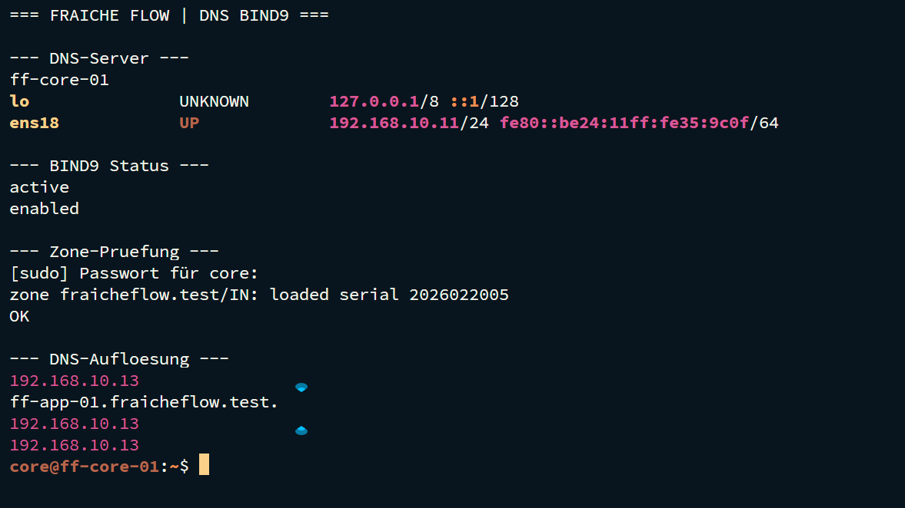

# DNS mit BIND9

MILOUD NECILI

Fraîche Flow · Fachinformatik Systemintegration

## Projektziel

Zentrale Namensauflösung für Hosts und Dienstnamen der internen Zone fraicheflow.test bereitstellen.

## Meine Umsetzung

- Die BIND-Zone auf ff-core-01 bearbeitet und SOA-Seriennummern kontrolliert erhöht.
- A-Record für ff-app-01 und Alias portal eingerichtet.
- Den Namen nextcloud.fraicheflow.test auf 192.168.10.13 aufgelöst.
- Zonensyntax geprüft, Zone neu geladen und direkte sowie clientseitige Abfragen verglichen.

## Technischer Rahmen

| **DNS-Server**            | 192.168.10.11                   |
| ------------------------- | ------------------------------- |
| **Zone**                  | fraicheflow.test                |
| **Zonendatei**            | `/etc/bind/db.fraicheflow.test` |
| **Belegte Serial-Stände** | 2026022004 und 2026022005       |

## Ergebnis

`named-checkzone` lieferte OK. Die Abfragen für ff-app-01, portal und nextcloud lieferten die erwartete Zuordnung zu 192.168.10.13.

## Prüfpfad und Betriebsnachweise

```bash
sudo named-checkzone fraicheflow.test /etc/bind/db.fraicheflow.test
sudo rndc reload fraicheflow.test
dig @192.168.10.11 nextcloud.fraicheflow.test +short
getent hosts ff-app-01.fraicheflow.test
```



## Troubleshooting aus der Praxis

Eine korrekt gespeicherte Zone war zunächst noch nicht geladen. Nach `rndc reload` wurde der neue Nextcloud-Record beantwortet. Ein falscher Client-Resolver verursachte unabhängig davon SSH-Namensfehler.

## Sicherheit und fachliche Einordnung

Vor Änderungen die Zonendatei sichern. Nur geprüfte Zonen laden. Der Kuma-Monitor mit dem Namen DNS ff-core-01 ist ein Ping-Test und kein DNS-Protokolltest.

## Kompetenztransfer

DNS-Zonenpflege, A/CNAME/MX-Verständnis, Resolver-Diagnose und kontrollierte Änderungen.

## Projektstatus

Abgeschlossen nach Bestätigung des Projektverantwortlichen.


