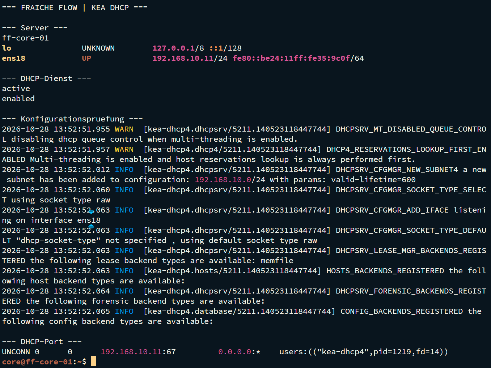

# DHCP mit Kea

MILOUD NECILI

Fraîche Flow · Fachinformatik Systemintegration

## Projektziel

Netzparameter zentral an Laborclients verteilen und die Konsistenz zwischen DHCP, DNS und statischen Serveradressen beachten.

## Meine Umsetzung

- Den Kea-DHCP-Aufgabenbereich auf ff-core-01 bearbeitet.
- Subnetz, Adresspool, Gateway und DNS-Optionen als zusammengehörige Konfiguration behandelt.
- Die dynamische Adresse von ff-mgmt-01 im Projektverlauf überprüft.
- Eine Abweichung zwischen DHCP-Adresse und DNS-Eintrag erkannt und bei der Dokumentation berücksichtigt.

## Technischer Rahmen

| **Serverrolle**   | ff-core-01                        |
| ----------------- | --------------------------------- |
| **Subnetz**       | 192.168.10.0/24                   |
| **Aufgaben-Pool** | 192.168.10.100 bis 192.168.10.150 |
| **Gateway / DNS** | 192.168.10.1 / 192.168.10.11      |

## Ergebnis

Eine DHCP-Adresse 192.168.10.100 wurde vom Projektverantwortlichen im früheren Verlauf angegeben. Ein vollständiger Lease-Export ist nicht Bestandteil der vorliegenden Nachweise.

## Prüfpfad und Betriebsnachweise

```bash
ip -br a
ip route
cat /etc/resolv.conf
getent hosts ff-mgmt-01.fraicheflow.test
```



## Troubleshooting aus der Praxis

Ein DNS-Eintrag zeigte zeitweise auf .50, während der Client .100 verwendete. Die Abweichung wurde als Ursache möglicher Zugriffsfehler erkannt.

## Sicherheit und fachliche Einordnung

Den Aufgaben-Pool nicht ungeprüft als aktuellen Sollwert übernehmen: .100 wurde auch für einen Windows-Storage-Host verwendet. Statische Adressen und DHCP-Bereich müssen kollisionsfrei sein.

## Kompetenztransfer

DHCP-Optionen, Clientkonfiguration, Adressmanagement und DNS-/DHCP-Konsistenz.

## Projektstatus

Abgeschlossen nach Bestätigung des Projektverantwortlichen.


