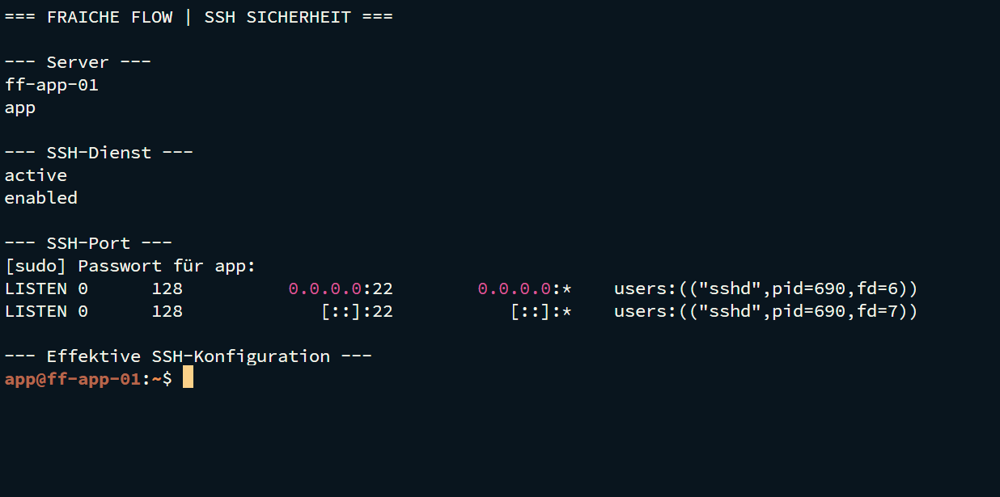
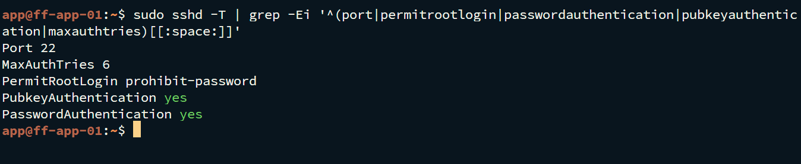

# SSH-Administration und Zugriffsschutz

MILOUD NECILI

Fraîche Flow · Fachinformatik Systemintegration

## Projektziel

Administrative Zugriffe nachvollziehbar absichern und Authentifizierung, Berechtigungen und Rückfallzugang getrennt prüfen.

## Meine Umsetzung

- OpenSSH für Remote-Administration und Jump-Verbindungen verwendet.
- SSH-Clientkonfiguration, Schlüsselzugriff und Härtung im Lernfeld-Aufgabenbereich bearbeitet.
- Administrative Befehle gezielt mit sudo ausgeführt.
- Zugriffsfehler zwischen Namensauflösung, Anmeldung und Dienstberechtigung unterschieden.

## Technischer Rahmen

| **Zielsysteme**    | ff-core-01, ff-app-01 und ff-mail-01                                          |
| ------------------ | ----------------------------------------------------------------------------- |
| **Client**         | ff-mgmt-01 / Termius                                                          |
| **Schutzprinzip** | Keine privaten Schlüssel in der Dokumentation |
| **Nachweisgrenze** | Effektive Konfiguration ist durch die beigefügte Terminalausgabe dokumentiert |

## Ergebnis

Der Login als app auf ff-app-01 ist nachgewiesen. Der SSH-Dienst ist aktiv und auf Port 22 erreichbar. Die effektive Konfiguration zeigt `PermitRootLogin prohibit-password`, `PubkeyAuthentication yes` und `PasswordAuthentication yes`. Ein global deaktivierter Passwort-Login wird daher nicht behauptet.

## Prüfpfad und Betriebsnachweise

```bash
ssh -V
ssh -v app@ff-app-01.fraicheflow.test
sudo sshd -t
sudo sshd -T | grep -Ei '^(port|permitrootlogin|passwordauthentication|pubkeyauthentication|maxauthtries)[[:space:]]'
```





## Troubleshooting aus der Praxis

Ein Apache-Reload ohne sudo scheiterte an der Autorisierung. Mit sudo und vorangehendem Syntaxcheck war die Änderung erfolgreich.

## Sicherheit und fachliche Einordnung

Vor Härtungsänderungen eine zweite Sitzung offenhalten und Syntax prüfen. Host-Key-Fingerprints unabhängig vergleichen. Effektive Konfiguration statt nur Dateiinhalte bewerten.

## Kompetenztransfer

Authentifizierung, Least Privilege, sichere Administration und Rückfallplanung.

## Projektstatus

Abgeschlossen nach Bestätigung des Projektverantwortlichen.


