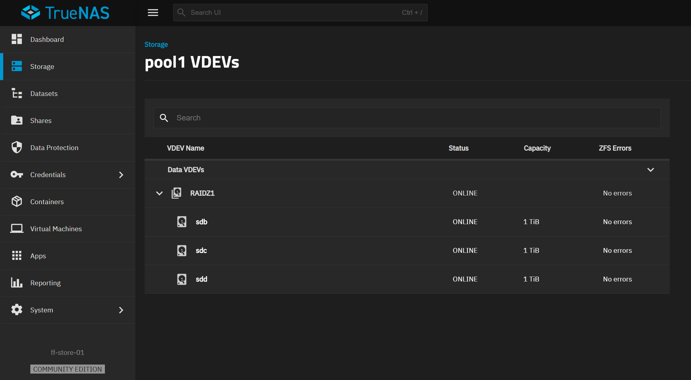

# TrueNAS und Windows Storage Spaces

MILOUD NECILI

Fraîche Flow · Fachinformatik Systemintegration

## Projektziel

Zwei Speicheransätze praktisch vergleichen und eine Storage-Plattform für die weitere Laborintegration auswählen.

## Meine Umsetzung

- TrueNAS mit einem RAIDZ1-Pool im Labor aufgebaut.
- Windows Storage Spaces mit Speicherpool, virtuellem Datenträger und Volume bearbeitet.
- Mirror und Thin Provisioning im Windows-Ansatz verwendet.
- TrueNAS als ff-store-01 für die nachfolgende iSCSI- und Backup-Anbindung genutzt.

## Technischer Rahmen

| **TrueNAS**                      | pool1 · RAIDZ1 · drei virtuelle Datenträger |
| -------------------------------- | ------------------------------------------- |
| **Windows**                      | pool1_disk1 · Mirror · Thin                 |
| **Windows-Kapazität im Verlauf** | 1,00 TB virtueller Datenträger              |
| **Storage-Adresse**              | ff-store-01 · 192.168.10.12                 |



## Ergebnis

Die Konfigurationen beider Speicheransätze wurden im früheren Projektverlauf besprochen und anhand von Oberflächen kontrolliert. TrueNAS ist im aktuellen Verlauf per Ping und iSCSI-Porttest erreichbar.

## Prüfpfad und Betriebsnachweise

```bash
ping -c 3 192.168.10.12
nc -vz 192.168.10.12 3260
```

## Troubleshooting aus der Praxis

Ein Windows Virtual Disk wurde zunächst versehentlich mit 1 GB angelegt. Der Fehler wurde vor der weiteren Nutzung korrigiert und der Datenträger mit 1 TB neu angelegt.

## Sicherheit und fachliche Einordnung

RAID ersetzt kein Backup. Thin Provisioning erfordert Kapazitätsüberwachung. Ein kontrollierter Plattenausfall oder Wiederaufbau wird nicht als durchgeführt ausgegeben.

## Kompetenztransfer

Storage-Design, Redundanz, Provisioning, Kapazitätskontrolle und begründete Plattformwahl.

## Projektstatus

Abgeschlossen nach Bestätigung des Projektverantwortlichen.


