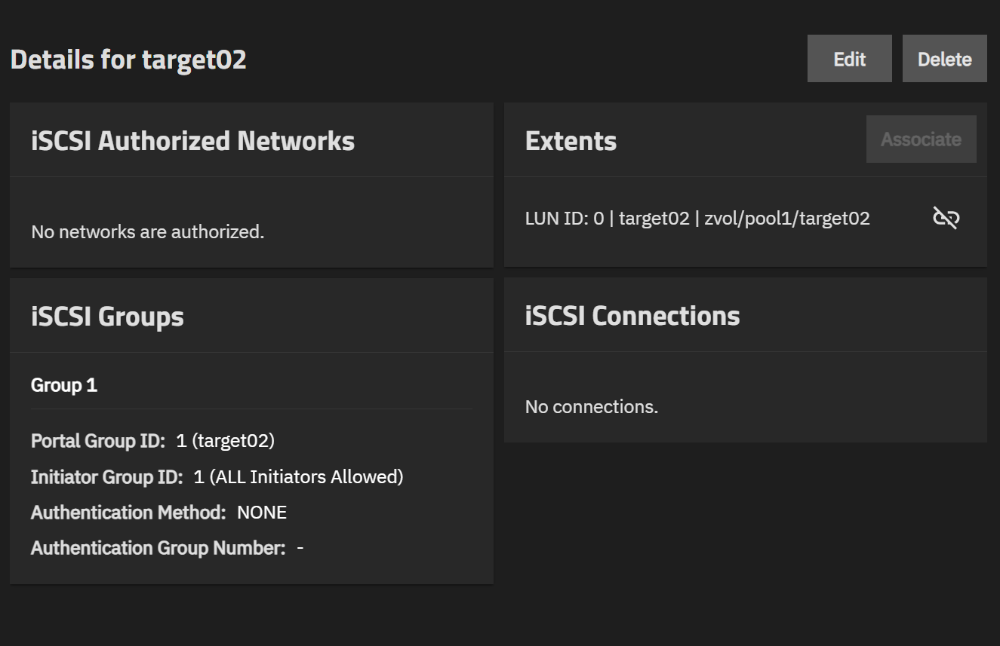
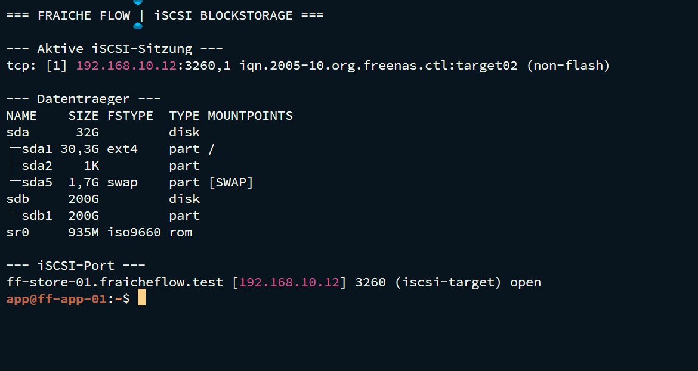
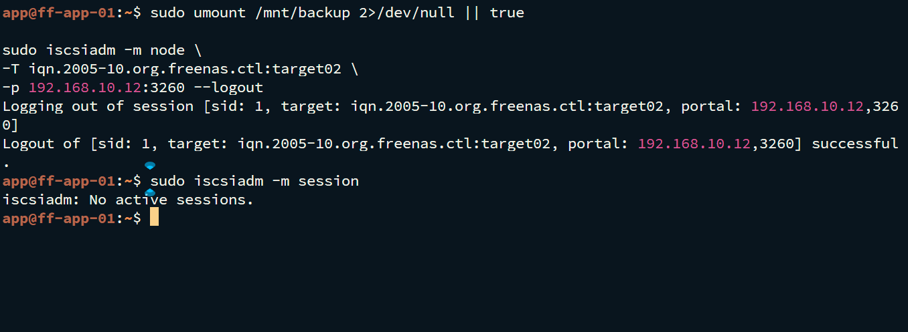

# iSCSI und Block-Storage

MILOUD NECILI

Fraîche Flow · Fachinformatik Systemintegration

## Projektziel

Ein separates Backup-Blockgerät von TrueNAS an ff-app-01 anbinden und kontrolliert wieder trennen.

## Meine Umsetzung

- Das Backup-Target target02 auf TrueNAS verwendet.
- Discovery und Login mit open-iscsi durchgeführt.
- Das zusätzliche Gerät partitioniert, mit ext4 formatiert und über UUID gemountet.
- Nach Nutzung zuerst das Dateisystem ausgehängt und danach die iSCSI-Sitzung beendet.



## Technischer Rahmen

| **Portal**          | 192.168.10.12:3260                               |
| ------------------- | ------------------------------------------------ |
| **Target**          | iqn.2005-10.org.freenas.ctl:target02             |
| **Mountpunkt**      | /mnt/backup                                      |
| **Mount-Zuordnung** | UUID-basiert; konkrete UUID nicht veröffentlicht |

## Ergebnis

Login und Logout wurden erfolgreich protokolliert. Nach Abschluss lieferte `findmnt` keine Ausgabe und `iscsiadm` meldete `No active sessions`.

## Prüfpfad und Betriebsnachweise

```bash
sudo iscsiadm -m session
lsblk -o NAME,SIZE,FSTYPE,MOUNTPOINTS
findmnt /mnt/backup
nc -vz 192.168.10.12 3260
```





## Troubleshooting aus der Praxis

Bei ausgeschaltetem TrueNAS war der Nachbareintrag INCOMPLETE und der Host nicht erreichbar. Nach dem Einschalten waren Ping und TCP/3260 wieder erfolgreich.

## Sicherheit und fachliche Einordnung

Gerätenamen vor jedem schreibenden Zugriff prüfen. Nie ein vorhandenes Backup erneut formatieren. target01/Proxmox-Anbindung ist laut Gesamtabschluss bearbeitet; ein separater Integrationstest liegt hier nicht vor.

## Kompetenztransfer

Target/Initiator-Verständnis, Blockgeräte, Mount-Lifecycle und Storage-Fehlerdiagnose.

## Projektstatus

Abgeschlossen nach Bestätigung des Projektverantwortlichen.


