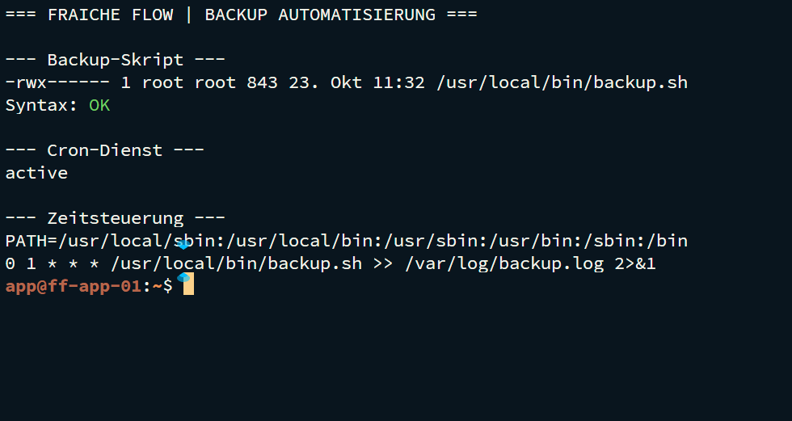
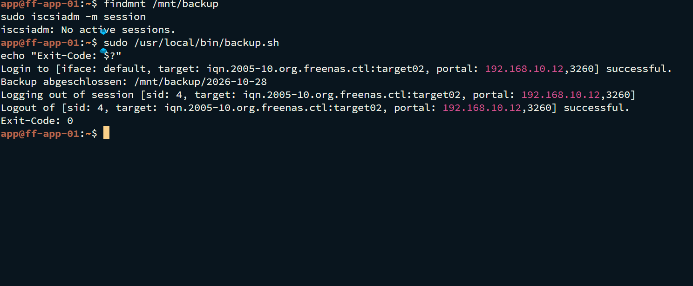
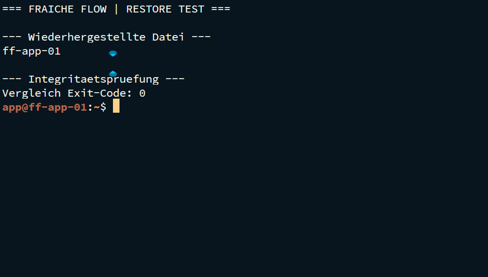

# Automatisiertes Backup und Restore


Fraîche Flow · Fachinformatik Systemintegration

## Projektziel

Konfigurationen und Webinhalte automatisiert sichern und die Wiederherstellbarkeit an konkreten Dateien überprüfen.

## Meine Umsetzung

- Das Backup-Skript `/usr/local/bin/backup.sh` verwendet und um `/var/www` erweitert.
- `/etc` und `/var/www` mit rsync in datierte Sicherungsverzeichnisse kopiert.
- Den root-Cronjob für täglich 01:00 Uhr mit Logumleitung eingerichtet.
- Dateibasierte Wiederherstellung und Vergleich der gesicherten Webseite durchgeführt.

## Technischer Rahmen

| **Sicherungsumfang** | `/etc` und `/var/www`                |
| -------------------- | ------------------------------------ |
| **Ziel**             | `/mnt/backup/<Datum>/`               |
| **Zeitsteuerung**    | `0 1 * * * /usr/local/bin/backup.sh` |
| **Log**              | `/var/log/backup.log`                |

## Ergebnis

Backup-Automatisierung, Logging und ein dateibasierter Restore-Test wurden im Projektverlauf bearbeitet. Die Wiederherstellung wurde durch Dateivergleich kontrolliert. Konkrete Original-Logdateien sind in dieser Bewerbungsfassung nicht beigefügt.

## Prüfpfad und Betriebsnachweise

```bash
sudo bash -n /usr/local/bin/backup.sh
sudo crontab -l
systemctl is-active cron
findmnt /mnt/backup; sudo iscsiadm -m session
```







## Troubleshooting aus der Praxis

Sicherungsumfang und Wiederherstellungsumfang wurden getrennt betrachtet. Ein erfolgreiches Kopieren ersetzt keinen Restore-Test; Dateirechte und Zielpfad gehören ebenfalls zur Prüfung.

## Sicherheit und fachliche Einordnung

Ein konfigurierter Cronjob beweist noch keinen zeitgesteuerten Lauf. Der belegte Test ist dateibasiert, kein Vollrestore. Laufende Datenbanken und Docker-Volumes benötigen ein eigenes konsistentes Sicherungskonzept.

## Kompetenztransfer

Bash-Automatisierung, rsync, Cron, Logging, Wiederherstellung und Nachweisführung.

## Projektstatus

Abgeschlossen nach Bestätigung des Projektverantwortlichen.


