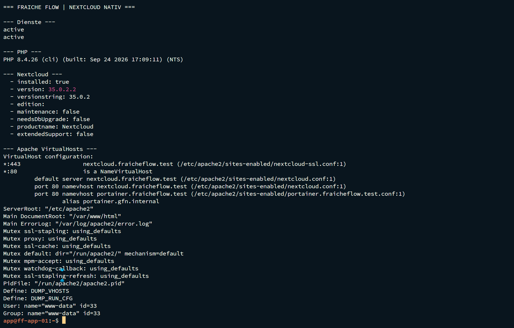
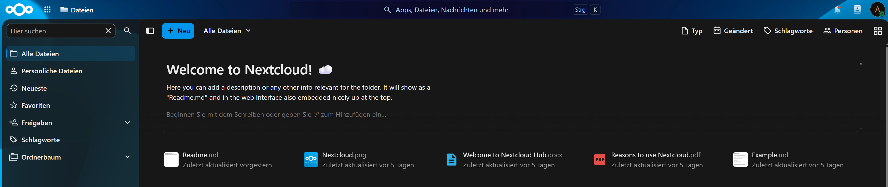

# Nextcloud auf Apache, PHP und MariaDB

MILOUD NECILI

Fraîche Flow · Fachinformatik Systemintegration

## Projektziel

Einen klassischen Webanwendungs-Stack installieren, Datenbankzugriff einrichten und Nextcloud über einen eigenen VirtualHost bereitstellen.

## Meine Umsetzung

- Apache, PHP-Erweiterungen und MariaDB auf ff-app-01 eingerichtet.
- `nextcloud_db` und den lokalen Datenbankbenutzer angelegt und berechtigt.
- Nextcloud unter `/var/www/nextcloud` bereitgestellt und Eigentümer auf `www-data` gesetzt.
- VirtualHost und DNS-Namen `nextcloud.fraicheflow.test` eingerichtet und die Weboberfläche erreicht.

## Technischer Rahmen

| **Webroot**         | `/var/www/nextcloud`                         |
| ------------------- | -------------------------------------------- |
| **Datenbank**       | `nextcloud_db`                               |
| **PHP**             | PHP-Laufzeit und Erweiterungen für Nextcloud |
| **MariaDB-Ausgabe** | 11.8.9 auf dem Host                          |

## Ergebnis

Apache lieferte `Syntax OK` und den Nextcloud-VirtualHost. Die Datenbankanmeldung war erfolgreich. HTTP lieferte Nextcloud-HTML; HTTPS leitete später auf `/index.php/login` weiter.

## Prüfpfad und Betriebsnachweise

```bash
sudo apache2ctl configtest
sudo apache2ctl -S
php --version
curl -I -H "Host: nextcloud.fraicheflow.test" http://127.0.0.1
```





## Troubleshooting aus der Praxis

Beim Entpacken traf `unzip` auf vorhandene Nextcloud-Dateien. Der Arbeitsstand wurde anschließend über Rechte, VirtualHost und HTTP-Ausgabe geprüft. Ein Datenbank-Loginfehler wurde durch Korrektur des Benutzerkennworts behoben.

## Sicherheit und fachliche Einordnung

Kennwörter nicht im Portfolio veröffentlichen. Die Datenbank speichert Metadaten, nicht standardmäßig die eigentlichen Nextcloud-Dateiinhalte. Ein vollständiger Datei-Upload-/Download-Test wird nicht aus HTML-Ausgaben abgeleitet.

## Kompetenztransfer

LAMP-Stack, SQL-Berechtigungen, PHP-Abhängigkeiten und VirtualHost-Diagnose.

## Projektstatus

Abgeschlossen nach Bestätigung des Projektverantwortlichen.


