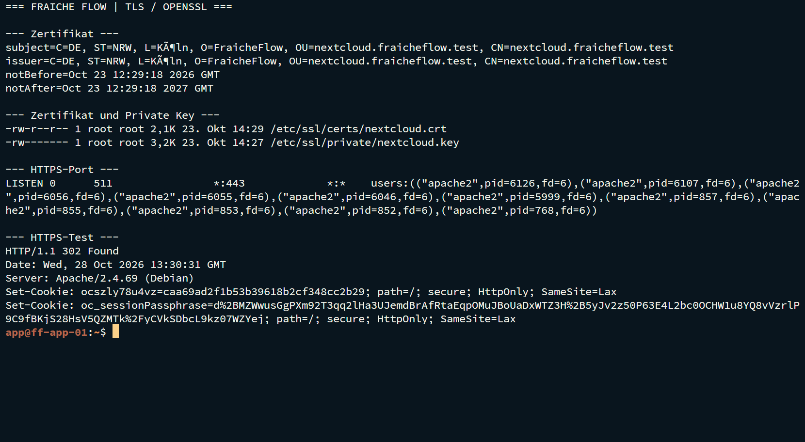

# TLS-Zertifikate und HTTPS


Fraîche Flow · Fachinformatik für Systemintegration

## Projektziel

Die Nextcloud-Webverbindung im Labor verschlüsseln und Zertifikat, privaten Schlüssel und Webserverkonfiguration getrennt verwalten.

## Meine Umsetzung

- Mit OpenSSL ein selbstsigniertes Zertifikat und einen RSA-Schlüssel erzeugt.
- Das Apache-SSL-Modul aktiviert und einen VirtualHost auf Port 443 eingerichtet.
- Zertifikats- und Schlüsselpfade in Apache eingebunden.
- HTTPS lokal sowie über SSH-Portweiterleitung getestet.

## Technischer Rahmen

| **Zertifikat**                  | `/etc/ssl/certs/nextcloud.crt`   |
| ------------------------------- | -------------------------------- |
| **Privater Schlüssel**          | `/etc/ssl/private/nextcloud.key` |
| **Schlüsselrechte im Nachweis** | `root:root · 600`                |
| **TLS-Endpunkt**                | `ff-app-01 · TCP/443`            |

## Ergebnis

Die Zertifikatsdateien wurden angezeigt. Apache führte VirtualHosts auf 80 und 443. `curl` über HTTPS lieferte 302 mit Weiterleitung zur Nextcloud-Anmeldung.

## Prüfpfad und Betriebsnachweise

```bash
sudo openssl x509 -in /etc/ssl/certs/nextcloud.crt -noout -subject -issuer -dates
sudo apache2ctl configtest
sudo apache2ctl -S
curl -k -I https://127.0.0.1
```



## Troubleshooting aus der Praxis

Der normale Benutzer konnte `/etc/ssl/private` nicht auflisten. Das war eine Berechtigungsgrenze, kein Nachweis einer fehlenden Datei. Mit `sudo` war der Schlüssel sichtbar.

## Sicherheit und fachliche Einordnung

Self-Signed verschlüsselt, ist aber nicht automatisch browserseitig vertrauenswürdig. `curl -k` überspringt die Zertifikatsprüfung. DuckDNS/Let’s Encrypt wurde besprochen; eine ausgestellte öffentliche Zertifikatskette ist nicht belegt.

## Kompetenztransfer

PKI-Grundlagen, TLS-Terminierung, Dateirechte und sichere Zertifikatsverwaltung.

## Projektstatus

Abgeschlossen nach Bestätigung des Projektverantwortlichen.


