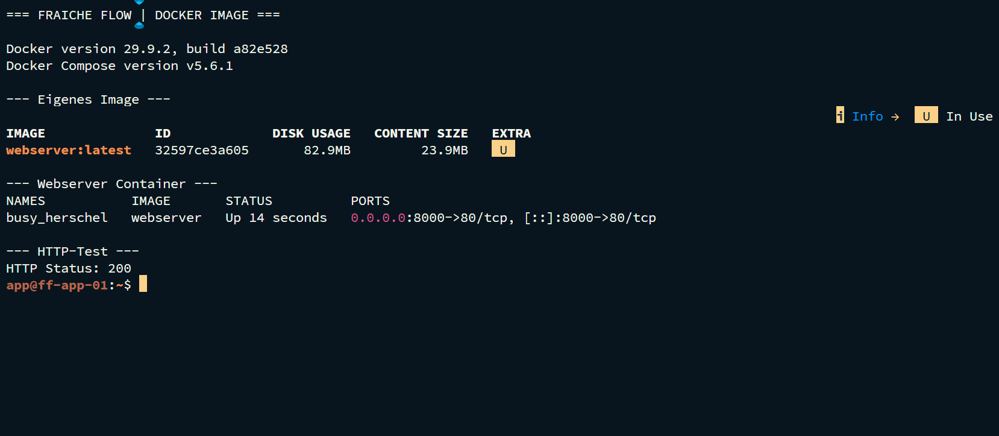

# Docker Engine und eigenes Webserver-Image

MILOUD NECILI

Fraîche Flow · Fachinformatik Systemintegration

## Projektziel

Containerbereitstellung verstehen und einen eigenen Webserver mit angepasstem HTML reproduzierbar als Image bauen.

## Meine Umsetzung

- Docker Engine und Docker Compose auf ff-app-01 genutzt.
- Ein Dockerfile mit Apache-Basisimage und eigener HTML-Datei erstellt.
- Das Image `webserver` gebaut und einen Container mit Port-Mapping `8000:80` gestartet.
- Nach Änderung der HTML-Datei einen Rebuild durchgeführt und den Zugriff vom Managementclient geprüft.

## Technischer Rahmen

| **Projektordner**               | `~/docker_apache` |
| ------------------------------- | ----------------- |
| **Image**                       | `webserver`       |
| **Host-/Containerport**         | `8000 → 80/TCP`   |
| **Engine / Compose im Verlauf** | `29.9.2 / v5.6.1` |

## Ergebnis

Der Container mit Image `webserver` war in `docker ps` als `Up` sichtbar. Der Webzugriff auf Port 8000 wurde im früheren Verlauf bestätigt und später im Monitoring aufgenommen.

## Prüfpfad und Betriebsnachweise

```bash
docker --version; docker compose version
docker images
docker ps --format "table {{.Names}}\t{{.Status}}\t{{.Ports}}"
curl -I http://192.168.10.13:8000
```



## Troubleshooting aus der Praxis

Eine Änderung an einer in das Image kopierten HTML-Datei wurde erst nach Neubau und neuem Container sichtbar. Hostdatei und Image-Inhalt wurden dadurch praktisch unterschieden.

## Sicherheit und fachliche Einordnung

Image-Versionen und Build-Kontext dokumentieren. Ein laufender Container ist noch kein vollständiger Anwendungstest. Persistente Daten nicht nur in der beschreibbaren Containerschicht halten.

## Kompetenztransfer

Dockerfile, Image-Build, Port-Mapping, Rebuild und HTTP-Funktionsprüfung.

## Projektstatus

Abgeschlossen nach Bestätigung des Projektverantwortlichen.


