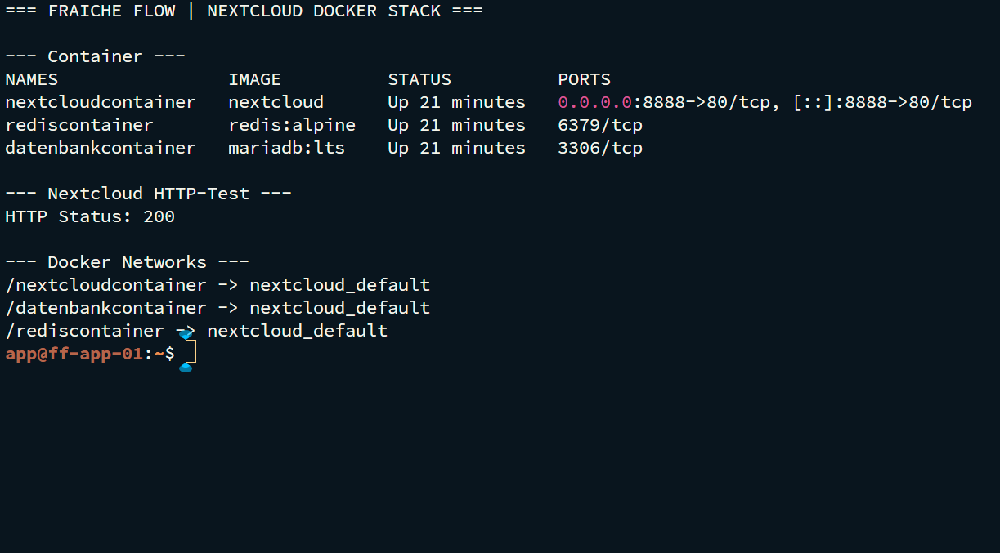

# Nextcloud-Stack mit MariaDB und Redis

MILOUD NECILI

Fraîche Flow · Fachinformatik Systemintegration

## Projektziel

Eine Webanwendung in getrennte Container für Anwendung, Datenbank und Cache überführen und als Stack betreiben.

## Meine Umsetzung

- Nextcloud als `nextcloudcontainer` mit Hostport 8888 bereitgestellt.
- MariaDB als `datenbankcontainer` und Redis als `rediscontainer` betrieben.
- Compose-Struktur, Port-Mapping und persistente Datenablage als zusammengehöriges Deployment behandelt.
- HTTP-Erreichbarkeit und Containerstatus geprüft und die Dienste in Kuma aufgenommen.

## Technischer Rahmen

| **Anwendung** | `nextcloudcontainer · 8888:80`                                     |
| ------------- | ------------------------------------------------------------------ |
| **Datenbank** | `datenbankcontainer · mariadb:lts`                                 |
| **Cache**     | `rediscontainer · redis:alpine`                                    |
| **Trennung**  | Zusätzlich zum nativen Nextcloud-Stack; keine behauptete Migration |

## Ergebnis

Alle drei Container wurden als `Up` angezeigt. Der HTTP-Test gegen `127.0.0.1:8888` lieferte 200. Im abschließenden Monitoring waren Nextcloud Docker, Docker MariaDB und Redis Container Online.

## Prüfpfad und Betriebsnachweise

```bash
docker ps --filter name=nextcloudcontainer
docker ps --filter name=datenbankcontainer --filter name=rediscontainer
curl -I http://192.168.10.13:8888
```



## Troubleshooting aus der Praxis

Die Datenbank und Redis hatten keine veröffentlichten Hostports. Für Kuma wurde zusätzliche Docker-Netzwerkanbindung verwendet, damit die Container intern erreichbar waren.

## Sicherheit und fachliche Einordnung

Keine Datenbankpasswörter in öffentliche Compose-Beispiele übernehmen. Manuelle `network-connect`-Änderungen sind nicht automatisch in Compose gespeichert und müssen vor einem Recreate deklarativ ergänzt werden.

## Kompetenztransfer

Mehrcontainer-Architektur, interne Servicekommunikation, Persistenz und Compose-Betrieb.

## Projektstatus

Abgeschlossen nach Bestätigung des Projektverantwortlichen.


