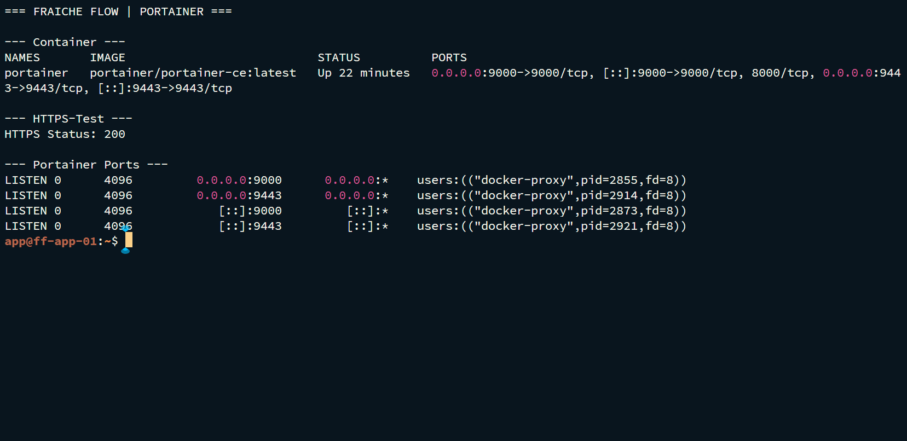
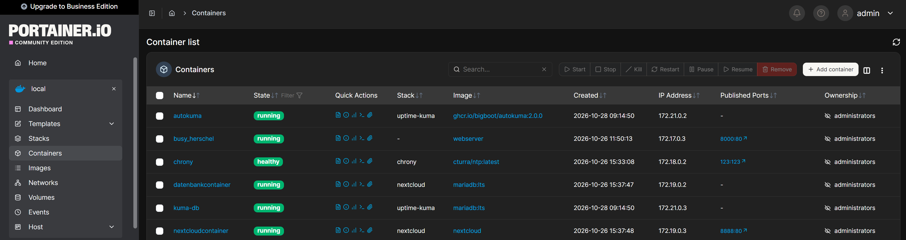

# Portainer als Containerverwaltung

MILOUD NECILI

Fraîche Flow · Fachinformatik Systemintegration

## Projektziel

Eine grafische Verwaltungsoberfläche für die vorhandene Docker-Umgebung bereitstellen und deren Zugriff prüfen.

## Meine Umsetzung

- Portainer CE als separaten Container auf ff-app-01 betrieben.
- Die veröffentlichten Ports und den Laufzustand über Docker geprüft.
- Die HTTPS-Oberfläche auf Port 9443 mit `curl` getestet.
- Den Endpunkt in die zentrale Überwachung aufgenommen.

## Technischer Rahmen

| **Container**             | `portainer`                     |
| ------------------------- | ------------------------------- |
| **Image im Verlauf**      | `portainer/portainer-ce:latest` |
| **Veröffentlichte Ports** | `9000/TCP` und `9443/TCP`       |
| **HTTP-Test**             | HTTPS auf 9443 lieferte 200     |

## Ergebnis

Portainer war in der Containerliste über mehrere Sitzungen als `Up` sichtbar. Der HTTPS-Test lieferte 200; der abschließende Portainer-Monitor war Online.

## Prüfpfad und Betriebsnachweise

```bash
docker ps --filter name=portainer
curl -k -I https://127.0.0.1:9443
```





## Troubleshooting aus der Praxis

Portainer-Zugangsdaten und Datenbankzugänge sind unterschiedliche Konten. Ein vergessenes Portainer-Kennwort wurde nicht durch Raten ersetzt; ein Passwortreset ist hier nicht als ausgeführt dokumentiert.

## Sicherheit und fachliche Einordnung

Portainer ist eine privilegierte Verwaltungsoberfläche. Zugang begrenzen, starke Kennwörter einsetzen und keine Docker-Socket-Zugriffe als harmlos behandeln.

## Kompetenztransfer

Containerinventar, Managementzugriff und administrative Schutzbedarfsbewertung.

## Projektstatus

Abgeschlossen nach Bestätigung des Projektverantwortlichen.


