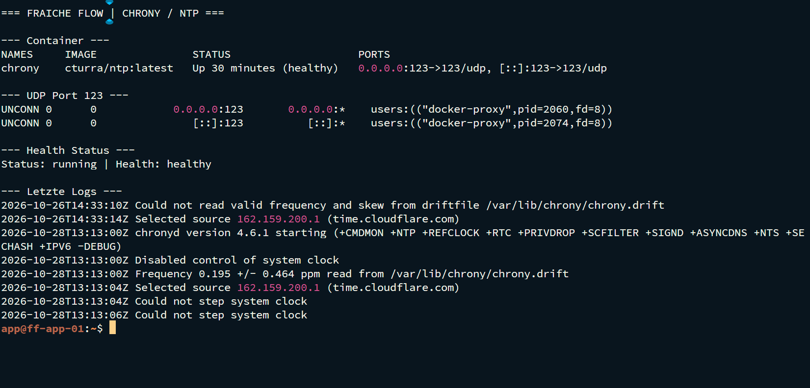

# Zeitdienst mit Chrony im Container

MILOUD NECILI

Fraîche Flow · Fachinformatik Systemintegration

## Projektziel

Einen Zeitdienst im Container bereitstellen und Laufzustand, Port und Aussagekraft des Monitorings unterscheiden.

## Meine Umsetzung

- Den Container `chrony` mit dem Image `cturra/ntp` betrieben.
- UDP-Port 123 am Host veröffentlicht.
- Den Docker-Healthstatus kontrolliert.
- Chrony in die zentrale Kuma-Übersicht aufgenommen.

## Technischer Rahmen

| **Container**    | `chrony`                                       |
| ---------------- | ---------------------------------------------- |
| **Image**        | `cturra/ntp:latest`                            |
| **Port**         | `123/UDP`                                      |
| **Kuma-Prüfung** | Ping auf Containername; kein NTP-Protokolltest |

## Ergebnis

Docker zeigte `chrony` als `Up (healthy)` mit veröffentlichtem UDP/123. Im abschließenden Screenshot ist Chrony Container Online.

## Prüfpfad und Betriebsnachweise

```bash
docker ps --filter name=chrony
docker logs --tail 30 chrony
sudo ss -lunp | grep ":123"
```



## Troubleshooting aus der Praxis

Ein Ping-Monitor beweist nur die Erreichbarkeit des Containerhosts. Er belegt weder korrekte Zeitabweichung noch eine erfolgreiche NTP-Synchronisation eines Clients.

## Sicherheit und fachliche Einordnung

Zeitquellen, zulässige Clients und UDP-Erreichbarkeit für produktiven Betrieb gesondert prüfen. Keine unbeabsichtigte öffentliche NTP-Freigabe.

## Kompetenztransfer

UDP-Dienste, Container-Healthchecks und Abgrenzung von Erreichbarkeit zu Dienstfunktion.

## Projektstatus

Abgeschlossen nach Bestätigung des Projektverantwortlichen.


