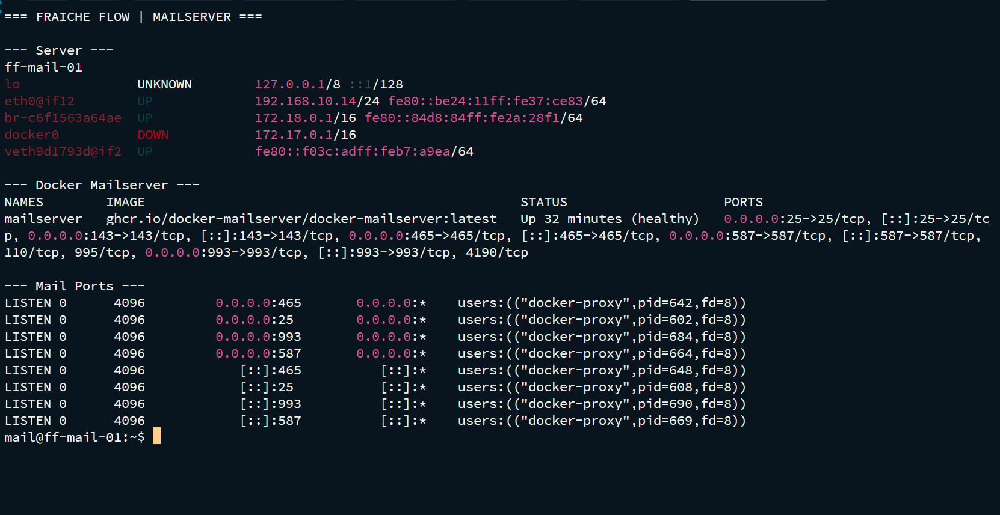
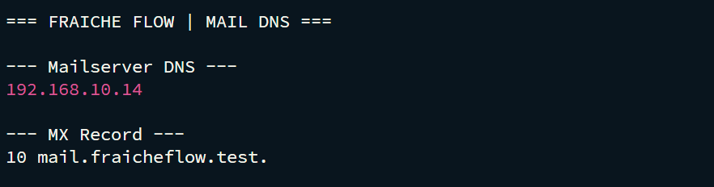

# Mailserver, DNS und Clientanbindung

MILOUD NECILI

Fraîche Flow · Fachinformatik Systemintegration

## Projektziel

Einen separaten internen Maildienst mit Containerbetrieb, DNS-Namen, TLS und Testpostfächern aufbauen.

## Meine Umsetzung

- Auf ff-mail-01 Docker Engine und Compose für den Mailserver eingerichtet.
- Docker Mailserver mit Umgebungsdatei und persistenten Mailverzeichnissen vorbereitet und gestartet.
- Zertifikate, DNS-/MX-Bezug und Postfächer im Labor eingerichtet.
- Thunderbird-/Clientzugriff über den SSH-Weiterleitungspfad bearbeitet; der Gesamtabschluss wurde vom Projektverantwortlichen bestätigt.

## Technischer Rahmen

| **Host / Dienstname**     | `ff-mail-01 / mail.fraicheflow.test`                 |
| ------------------------- | ---------------------------------------------------- |
| **Container**             | `mailserver`                                         |
| **Image im Verlauf**      | `ghcr.io/docker-mailserver/docker-mailserver:latest` |
| **Testkonten im Verlauf** | `admin` und `student`; keine Kennwörter enthalten    |

## Ergebnis

Die frühere Konversation enthält den Aufbau von Compose und `mailserver.env` sowie Container- und Kontenarbeit. Eine vollständige SMTP-Transaktion mit Message-ID wird nicht als Originalnachweis in dieser Sammlung ausgegeben.

## Prüfpfad und Betriebsnachweise

```bash
docker compose config -q
docker ps --filter name=mailserver
docker logs --tail 40 mailserver
dig @192.168.10.11 fraicheflow.test MX
```





## Troubleshooting aus der Praxis

Compose meldete zunächst eine fehlende `mailserver.env`. Nach Bereitstellung der Umgebungsdatei wurde die Konfiguration weitergeführt. Clientname, Zertifikatsname und Tunnelziel mussten getrennt betrachtet werden.

## Sicherheit und fachliche Einordnung

Ein interner Mailtest ist kein Nachweis öffentlicher Zustellbarkeit. SPF, DKIM, DMARC, PTR, Relay-Schutz und Alarmzustellung sind eigenständige Prüfbereiche. Roundcube wird nicht als installiert behauptet.

## Kompetenztransfer

LXC-/Docker-Einordnung, Mailprotokolle, DNS-MX, TLS und Clientanbindung.

## Projektstatus

Abgeschlossen nach Bestätigung des Projektverantwortlichen.


