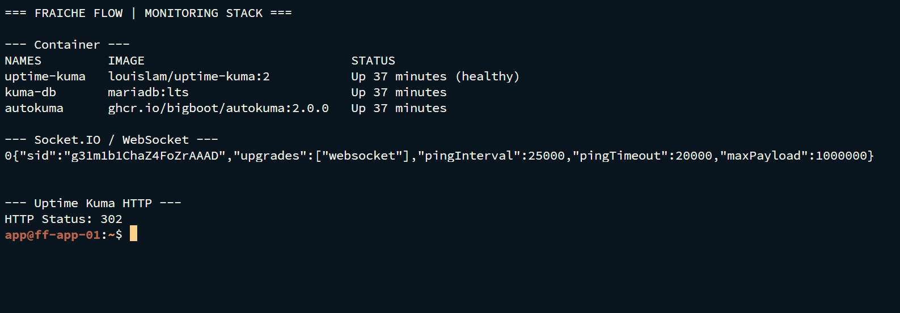
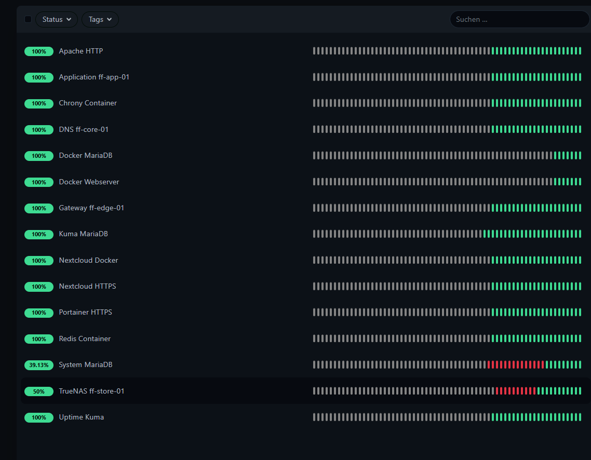

# Zentrales Monitoring mit Uptime Kuma

MILOUD NECILI

Fraîche Flow · Fachinformatik Systemintegration

## Projektziel

Die Laborinfrastruktur zentral überwachen und Monitore automatisiert statt einzeln über die Oberfläche bereitstellen.

## Meine Umsetzung

- Uptime Kuma 2.5.8 mit separater MariaDB im Compose-Projekt betrieben.
- AutoKuma 2.0.0 über Docker-Labels zur automatischen Monitoranlage eingesetzt.
- HTTP-, TCP-Port- und Ping-Prüfungen für 15 Endpunkte eingerichtet.
- Socket.IO-, Datenbank- und Erreichbarkeitsfehler anhand von Logs und Heartbeats eingegrenzt.

## Technischer Rahmen

| **Container**     | `uptime-kuma`, `kuma-db`, `autokuma` |
| ----------------- | ------------------------------------ |
| **Projekt**       | `~/docker/uptime-kuma`               |
| **Zugriff**       | Termius: lokal 13001 → intern 3001   |
| **Abschlussbild** | 15 Online · 0 Offline · 0 Unbekannt  |

## Ergebnis

Das beigefügte Abschlussbild zeigt 15 Online-Monitore und 0 Offline. Für System MariaDB zeigten fünf aufeinanderfolgende Heartbeats `status=1`. Historische Verfügbarkeit blieb teilweise unter 100 Prozent.

## Prüfpfad und Betriebsnachweise

```bash
docker ps --filter name=uptime-kuma --filter name=kuma-db --filter name=autokuma
docker logs --tail 40 autokuma
curl --max-time 10 -sS "http://127.0.0.1:3001/socket.io/?EIO=4&transport=polling"
```



## Troubleshooting aus der Praxis

YAML-Einrückung, anfängliche EngineIO-Verbindungsfehler und Socket.IO-Unterbrechungen wurden untersucht. `ER_DUP_ENTRY` in `stat_daily` und `stat_hourly` trat auf; eine dauerhafte Fehlerbehebung dieses Statistikproblems ist nicht belegt.

## Sicherheit und fachliche Einordnung

TCP-Prüfungen auf 443 und 9443 validieren weder TLS-Zertifikate noch Login. Ping auf DNS und Chrony prüft nicht das jeweilige Protokoll. Docker-Socket und Admin-Zugang sind besonders schutzbedürftig.

## Kompetenztransfer

Observability, deklarative Monitoranlage, Logkorrelation und Interpretation von Verfügbarkeit.

## Abschlussnachweis: Monitoring



Die Historie zeigt für System MariaDB 39,13 % und für TrueNAS 50 %. Die aktuelle Erreichbarkeit ist grün; daraus folgt keine durchgängige historische Verfügbarkeit von 100 %.

## Überwachte Endpunkte

- HTTP: Uptime Kuma, Nextcloud Docker, Docker Webserver.
- TCP-Port: Apache HTTP, Nextcloud HTTPS, Portainer HTTPS, System MariaDB, Kuma MariaDB, Docker MariaDB, Redis Container.
- Ping: Application ff-app-01, Chrony Container, DNS ff-core-01, Gateway ff-edge-01, TrueNAS ff-store-01.

Die Monitorbezeichnungen sind Projektnamen. Ein TCP-Porttest auf HTTPS ersetzt keine Zertifikatsprüfung; ein Ping-Test auf DNS oder Chrony ersetzt keinen DNS- oder NTP-Funktionstest.

## Projektstatus

Abgeschlossen nach Bestätigung des Projektverantwortlichen.


