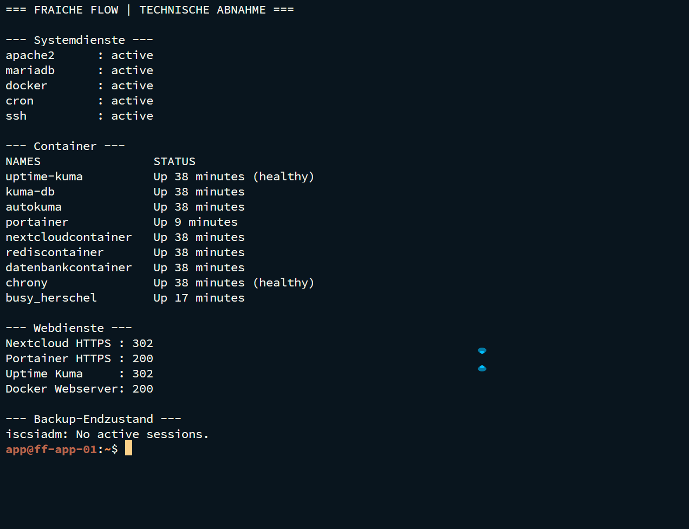

# Abnahme, Wiederanlauf und Betriebsübergabe

PROJEKT / Tag 6 / Tag 10 · Abnahme und Reflexion

Fraîche Flow · Lernfeld 10b · Fachinformatik Systemintegration

## Projektziel

Die umgesetzte Laborinfrastruktur anhand von Anforderungen, Tests, Risiken und Wiederanlaufabhängigkeiten nachvollziehbar übergeben.

## Meine Umsetzung

- Anforderungen, Nachweise, Abnahmekriterien und Blocker im Projektkontext eingeordnet.
- Die Rollen der beteiligten Systeme und den End-to-End-Prüfpfad dokumentiert.
- Ein dateibasiertes Restore-Ergebnis und einen Wiederanlaufablauf festgehalten.
- Runbook und technische Unterlagen zur Übergabe der Laborarbeit erstellt.

## Technischer Rahmen

| **Abschluss** | Alle Aufgaben laut Projektverantwortlichem bearbeitet |
| --- | --- |
| **Belegte Kette** | DNS → SSH/HTTP → Anwendung; Backup → Vergleich → Trennung |
| **Monitoring** | 15 Endpunkte im Abschlussbild Online |
| **Betriebsrahmen** | Schulungs-/Praxislabor, keine behauptete Produktivabnahme |

## Ergebnis

Der technische Laborstand ist dokumentiert. Der Projektabschluss beruht auf der Abschlussbestätigung und den vorhandenen Ausgaben. Ein produktives SLA, Vollrestore oder formaler Kundensign-off wird nicht daraus abgeleitet.

## Prüfpfad und Betriebsnachweise

```bash
systemctl is-active apache2 mariadb docker cron
docker ps
findmnt /mnt/backup
sudo iscsiadm -m session
```



## Troubleshooting aus der Praxis

Die Störungsbearbeitung zeigte, warum Online-Zustand, historische Verfügbarkeit und tatsächlicher Anwendungstest getrennt bewertet werden müssen. Ein abgeschalteter TrueNAS-Host wurde korrekt als Ausfall erkannt.

## Sicherheit und fachliche Einordnung

Für einen Produktivtransfer: Geheimnisse rotieren, Netzwerkfreigaben begrenzen, konsistente Datenbanksicherungen und vollständigen Restore testen sowie Benachrichtigungskette nachweisen. Dies sind Ausbauempfehlungen, keine nachträglich erfundenen Laborfehler.

## Kompetenztransfer

Betriebsdokumentation, Risikoabwägung, Wiederanlaufplanung und transparente Übergabe.

## Projektstatus

Abgeschlossen nach Bestätigung des Projektverantwortlichen.


